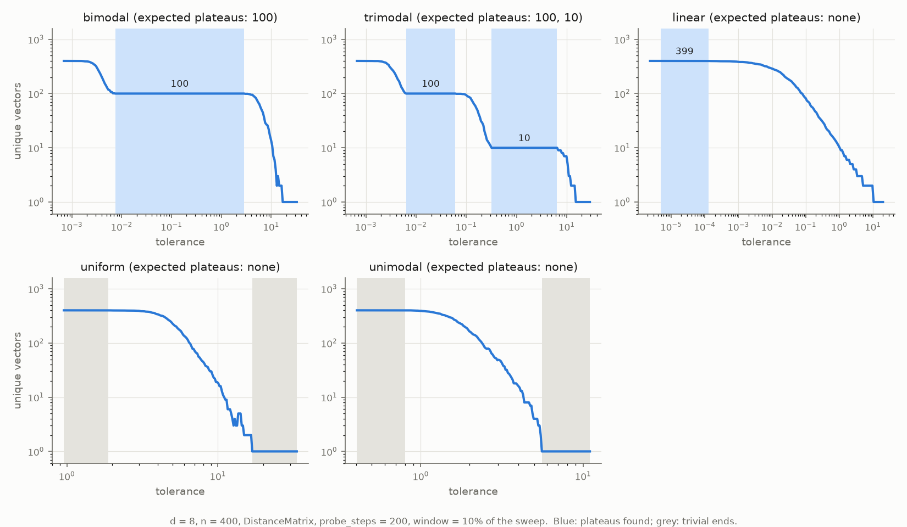
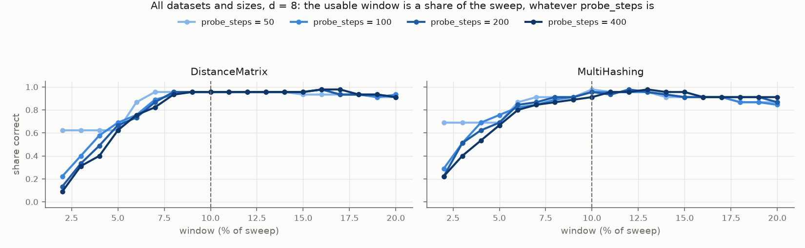
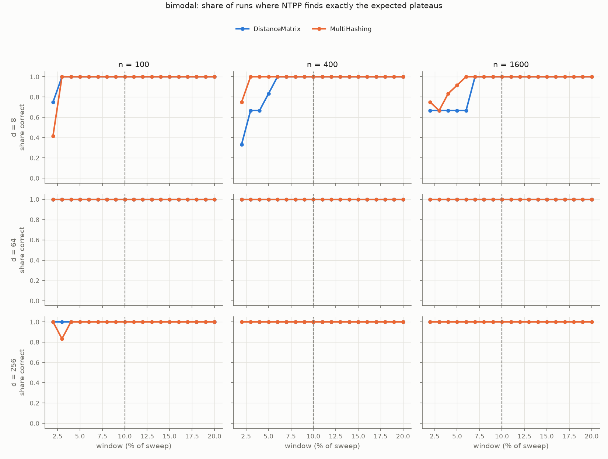
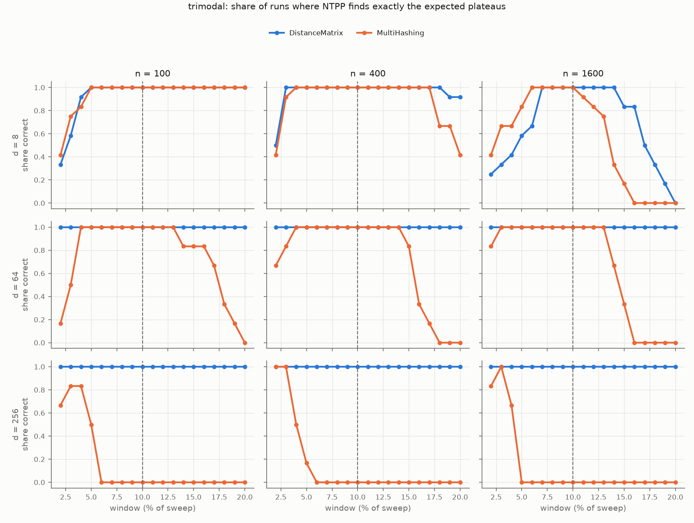
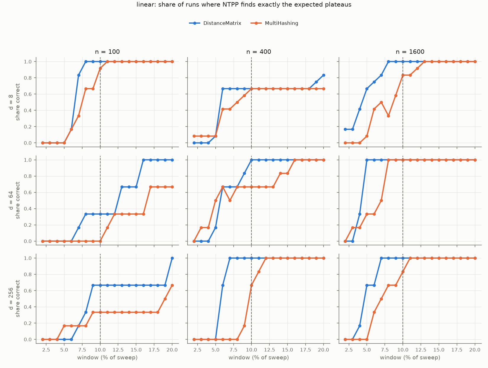
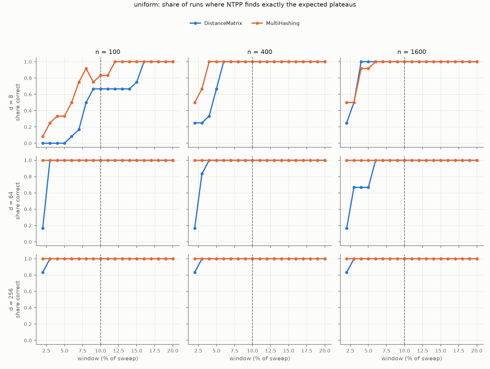
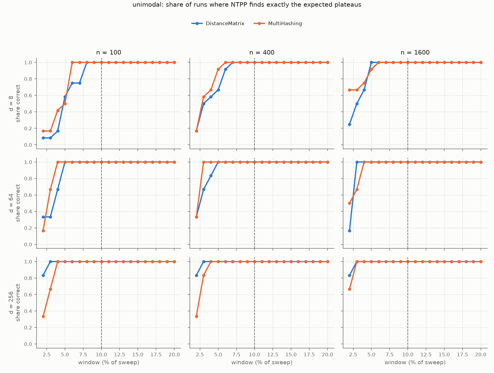

Tolerance Calculators
=====================

Tolerance calculators automatically find a ``tolerance`` value for a given
dataset and DDA.  Run the calculator once, then assign the result to
``dda.tolerance`` before calling ``deduplicate()`` or ``duplicate_check()``.
They tune on a sample of ``sample_size`` vectors (see :doc:`../large_datasets`)
and never modify the DDA they are given.

.. autoclass:: deduplicate_lib.core.tolerance_calculator.ToleranceCalculator
   :members: binary_search_tolerance

.. autofunction:: deduplicate_lib.core.tolerance_calculator.draw_sample

PerturbedDatasetReclustering
-----------------------------

Follows each sampled vector with ``perturbations_per_vector - 1`` copies
carrying Gaussian noise of scale ``perturbation_scale``, then binary-searches
for the tolerance at which the copies collapse back onto their originals.
``"average"`` mode averages the loose and tight bounds; ``"loose"`` returns the
highest valid tolerance; ``"tight"`` returns the lowest.

.. autoclass:: deduplicate_lib.plugins.tolerance_calculators.perturbed_dataset_reclustering.PerturbedDatasetReclustering
   :members: calculate_tolerance
   :show-inheritance:

NaturalTolerancePlateauProbe
-----------------------------

No perturbed data needed.  Sweeps log-spaced tolerances from below the
all-different bound to above the all-same bound, records the unique-structure
count at each step, and finds plateaus — regions where the clustering is stable
and insensitive to small changes in tolerance, i.e. natural clustering scales.
``find_natural_plateaus()`` lists them; ``calculate_tolerance()`` returns the
midpoint of the longest, tightest or loosest one (the trivial all-unique and
all-same plateaus at the ends are never chosen).

.. autoclass:: deduplicate_lib.plugins.tolerance_calculators.natural_tolerance_plateau_probe.NaturalTolerancePlateauProbe
   :members: calculate_tolerance, find_natural_plateaus
   :show-inheritance:

.. autoclass:: deduplicate_lib.plugins.tolerance_calculators.natural_tolerance_plateau_probe.Plateau

Choosing the gradient window
^^^^^^^^^^^^^^^^^^^^^^^^^^^^

A plateau is a run of probe steps over which the unique-vector count barely
changes, measured over a window of ``datapoints_to_calculate_gradient`` steps.
The window is a trade-off:

* **Too small**, and noise in the curve shows up as false plateaus.  The
  random gaps between vectors of data with no structure make short flat
  stretches.
* **Too large**, and genuine plateaus shorter than the window are missed.

By default the window is 10% of ``probe_steps`` (``DEFAULT_WINDOW_FRACTION``),
chosen from the study below.  Pass an integer to override it.

The study sweeps synthetic datasets with a known answer, for 8, 64 and 256
dimensions, 100, 400 and 1600 vectors, both DDAs, 50 to 400 probe steps and
3 seeds (720 sweeps).  Every window from 2% to 20% of the sweep is then
scored on whether NTPP finds exactly the expected non-trivial plateaus:

* **bimodal**: groups of 4 near-duplicates, so one plateau, at n/4.
* **trimodal**: super-clusters of clusters of near-duplicates, so two plateaus.
* **linear**, **uniform**, **unimodal**: points along a line, uniform in a
  hypercube, and a single Gaussian.  These have no natural scale, so the
  right answer is no plateau at all.

The figures come from ``docs/scripts/ntpp_window_study.py``, which can be
re-run to reproduce them.

         plateaus NTPP finds shaded.

   What NTPP sees: the unique-vector count across the sweep for each dataset
   (d = 8, n = 400, DistanceMatrix), with the plateaus found at the default
   window shaded.  Bimodal and trimodal give their expected plateaus.  The
   linear dataset shows the main failure mode on data with no structure: a
   plateau just below "all unique" (399 of 400), where its closest pair has
   merged long before the next one.  NTPP cannot tell this apart from a
   dataset that really has one near-duplicate pair.

.. list-table:: Share of runs with exactly the expected plateaus
   :header-rows: 1

   * - window (% of sweep)
     - 4%
     - 6%
     - 8%
     - **10%**
     - 12%
     - 15%
   * - bimodal, trimodal (right plateaus found)
     - 90%
     - 91%
     - 94%
     - **94%**
     - 93%
     - 88%
   * - linear, uniform, unimodal (no false plateau)
     - 54%
     - 75%
     - 86%
     - **91%**
     - 93%
     - 94%

**The window is a share of the sweep, not a number of steps.**  The noise in
the curve spans a fixed range of tolerance.  Probing more finely only samples
the same noise more often, so the window must span the same share of the
sweep whatever ``probe_steps`` is.  More probe steps only make the plateau
edges sharper:

         value, nearly identical.

   All datasets and sizes at d = 8: the curves for 50 to 400 probe steps lie
   on top of each other once the window is given as a share of the sweep.

Per dataset, by dimension (rows) and dataset size (columns), pooled over
probe densities and seeds.  The dashed line marks the default window:

   Bimodal: the single plateau is wide and is found at any window from
   about 8%.

   Trimodal: DistanceMatrix finds both plateaus at every dimension.
   MultiHashing's coarse plateau shrinks as the dimension grows and drops
   out above about 13% at d = 64.  At d = 256 it is too narrow for any but
   the smallest windows (see the limitations below).

   Linear: the hardest case.  The near-"all unique" plateau described above
   needs windows of 10-20% to suppress, and is never suppressed in some
   configurations.

   Uniform: in 8 dimensions false plateaus remain in about 1 run in 10 even
   at 10-15%, mostly with few vectors (n = 100).  In 64 and 256 dimensions
   there are none from about 6% upwards.

   Unimodal (Gaussian): no false plateaus from about 8%.

**Limitations.**

* *Data with few duplicates.*  On data with no clustering, NTPP can report a
  plateau just below "all unique", because the closest pair or two merge long
  before the rest.  Check ``find_natural_plateaus()``: a plateau whose
  ``unique_vectors`` is close to the sample size means very few duplicates.
  ``"tightest"`` will pick it.
* *MultiHashing in high dimensions.*  MultiHashing rounds every coordinate to
  the ``tolerance`` grid, so coarse clusters only merge once the tolerance
  nears the spread of the coordinates, just below its all-same tolerance.  In
  high dimensions this squeezes the coarsest plateau against the top of the
  sweep.  It may be missed, or found much narrower than with DistanceMatrix.
  Finer scales, such as near-duplicates, are unaffected.  If you need the
  coarse scale, tune with a ``DistanceMatrix`` on a small sample, or set a
  smaller ``datapoints_to_calculate_gradient`` and inspect the plateaus.
